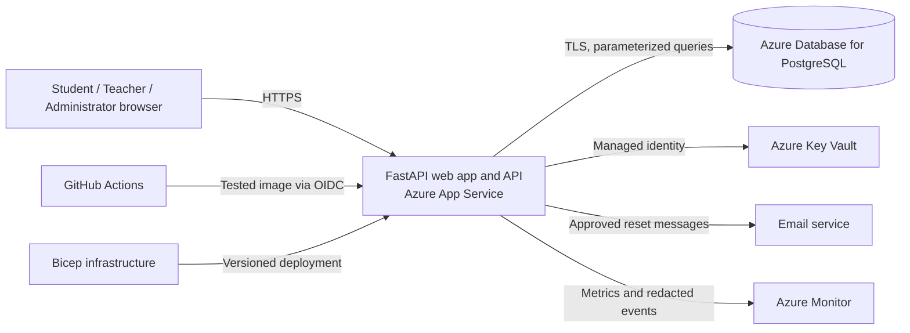

# Proposal: MMAUG High School Secure Login Portal

**RFP:** MMAUG-AIDB-RFP-002  
**Customer:** MMAUG High School, Sliema, Malta  
**Submitted by:** Independent developer  
**Date:** 3 November 2026  
**Status:** Proposed solution; implementation and acceptance testing are pending

## 1. Executive summary

MMAUG High School needs a dependable entry point for approximately 1,200 students and 150 staff. Its current systems have inconsistent access controls, manual account administration, and limited sign-in visibility. I propose a secure web portal built with **Python FastAPI** that gives students, teachers, and administrators the access appropriate to their role. The first release will provide sign-in, sign-out, recovery, role-specific dashboards, protected APIs, account administration, and an auditable record of security events.

The solution uses one modular application, a managed PostgreSQL database, and automated deployment. This keeps the system manageable for a solo developer while leaving room for future school services. The delivery includes a working MVP and the tests, documentation, monitoring, and deployment controls needed to assess it for production use. A production release will occur only after the customer approves the open policy decisions and the release gates in Section 10 pass.

## 2. Outcomes and scope

The proposed MVP will:

| RFP outcome | Proposed capability | Acceptance evidence |
| --- | --- | --- |
| Secure central sign-in | Named accounts; sign-in, sign-out, password reset; protected sessions | Successful and failed login, logout, reset, and expired-session demonstrations |
| Least-privilege access | Student, teacher, and administrator roles; server-side checks on every protected route and data record | Role matrix and automated denial tests, including changed URLs and client values |
| Appropriate dashboards | Separate dashboard views and API responses for each role | Live demonstration using all three roles |
| Controlled administration | Administrators can list users, activate/deactivate accounts, and change an allowed role | Audit trail and immediate access revocation after deactivation or role change |
| Visibility | Login history, failed attempts, recovery, privilege changes, and admin actions | Searchable, access-controlled audit view and alert demonstration |
| Repeatable delivery | Source control, tests, security checks, infrastructure as code, and automated deployment | Pipeline run linked to a commit and deployed version |
| Growth | Capacity for at least 1,500 registered accounts | Seeded load test, measured results, and scale plan |

The MVP contains a minimal student profile so ownership checks can be demonstrated. It does **not** include grades, attendance, messaging, timetable, payments, or integrations with existing school systems. Those require separate requirements, data agreements, and authorization rules. No AI or machine-learning feature is proposed for the identity system: the RFP makes AI optional, and an unnecessary model would add privacy and security risk. Future analytics, if requested, would use approved, minimized audit data and undergo a separate review.

## 3. Requirements, assumptions, and decisions needed

### Working assumptions

1. The school will designate a product owner to approve access rules, privacy decisions, and user acceptance results.
2. The first release will use school-provisioned accounts. Public self-registration is out of scope.
3. Each user has one active role in the MVP. A change of role is a logged administrative action. Multi-role accounts require a later policy decision.
4. A verified school email address is available for staff recovery. Student recovery uses verified school email only if the school confirms that channel; otherwise a controlled administrator-assisted reset is used.
5. The school can provide an Azure subscription, domain, email delivery service, and a secure administrator enrollment process before deployment. Equivalent managed services can be substituted during discovery if cost or policy requires it.
6. The portal holds only the data required for identity, role, account status, minimal dashboard content, and audit events. It is not yet a student information system.

### Questions for the customer, ordered by delivery impact

| Priority | Decision required | Effect on the design |
| --- | --- | --- |
| 1 | Does the school already use Microsoft Entra ID or another identity provider? | If so, federated sign-in may replace local password storage and recovery for eligible users. The FastAPI authorization layer remains. |
| 1 | Who may create accounts, approve role changes, and recover student accounts? | Defines the administrative workflow and safeguards for minors. |
| 1 | What personal data may appear on each dashboard, especially teacher access to student data? | Determines record-level authorization and privacy boundaries. |
| 1 | What are the required retention periods, lawful basis, and incident contacts for account and audit data? | Determines retention jobs, export/deletion process, and incident runbook. |
| 2 | What are the expected peak concurrent users, school hours, and availability target? | Determines load test and hosting size. |
| 2 | Which email service, domain, Azure region, and hosting budget are approved? | Determines deployment configuration and recurring cost. |
| 2 | Should MFA be mandatory for teachers as well as administrators? | Determines enrollment and support workload. |

The design below is the baseline if no existing identity provider is available. Any changed assumption will be recorded in a decision log and reflected in the acceptance tests.

## 4. Proposed architecture and data flow

The application is a **modular monolith**: one FastAPI service with separate authentication, authorization, administration, dashboard, audit, and API modules. Jinja2 templates and small amounts of browser JavaScript provide the UI. This avoids a separate frontend deployment and duplicated security logic. The application uses SQLAlchemy for data access and Alembic for versioned schema changes. PostgreSQL is the shared source of truth for accounts, sessions, reset tokens, and audit events.

**Request path:** The browser connects over HTTPS. On sign-in, the server verifies the account, password, and required MFA; creates a new random opaque session ID; stores only its hash and expiry in the database; and sends the ID in a `Secure`, `HttpOnly`, `SameSite` cookie. Each subsequent request resolves the active session, reloads current account status and role, and checks the requested action and record. Sign-out or deactivation revokes active sessions. Reset links carry random, single-use, short-lived tokens whose hashes are stored server-side. Secrets come from Key Vault through the app's managed identity. Audit events and operational metrics flow to the monitoring service without passwords, tokens, or student content.

FastAPI supplies the web/API framework and dependency mechanism; its documentation uses Argon2 password hashing in its current security example. The session design deliberately uses a revocable server-side record because Starlette's built-in session middleware uses readable, signed cookie content, which is less suitable for immediate account revocation in this portal. [FastAPI security guide](https://fastapi.tiangolo.com/tutorial/security/oauth2-jwt/); [Starlette session middleware](https://www.starlette.io/middleware/).

### Application and data design

| Component | MVP design |
| --- | --- |
| `users` | UUID, normalized unique login identifier, display name, password hash or external identity reference, role, active state, MFA state, timestamps |
| `sessions` | Hash of opaque session ID, user ID, creation/last-activity/absolute-expiry timestamps, revocation state |
| `reset_tokens` | Token hash, user ID, expiry, one-time-use state; scheduled cleanup |
| `audit_events` | UTC time, event type, actor, target, result, request ID, limited source metadata; append-only through application permissions |
| `student_profiles` | Minimal demo profile keyed to user ID; readable only by that student and an explicitly authorized administrator |

Representative protected routes are `GET /api/me`, `GET /api/dashboard`, `GET /api/student/profile`, `GET /api/admin/users`, `PATCH /api/admin/users/{id}/status`, and `PATCH /api/admin/users/{id}/role`. The public routes are limited to sign-in and recovery initiation/completion. UI links never substitute for server authorization. API responses include only fields required by the caller. A teacher dashboard has teacher-specific content but no general student roster in the MVP.

## 5. Identity, security, and privacy controls

| Control | Implementation and verification |
| --- | --- |
| Passwords | Argon2id hashes using a maintained library; no plaintext storage or logging; long passphrases and common-password rejection. Parameters are benchmarked and documented for the hosting tier. |
| MFA | Mandatory for administrators; recommended for teachers pending customer policy. If no managed identity provider is available, use a maintained TOTP library with encrypted enrollment secrets and one-time recovery codes. No SMS dependency is assumed. |
| Credential attacks | Shared account/IP rate limits, progressive delay, temporary lock after repeated failures, generic authentication errors, and alerting. Thresholds are tuned in UAT to avoid denying legitimate students. |
| Sessions | New session after authentication, idle and absolute expiry, explicit server-side revocation on logout, reset, deactivation, and role change; reauthentication for sensitive admin actions. Proposed defaults: 30-minute idle and 12-hour absolute expiry, shorter for administrators if the school approves. |
| Recovery | Generic response that does not reveal whether an account exists; single-use reset token with a proposed 30-minute validity; verified delivery channel; reset event logged and existing sessions revoked. |
| Authorization | Deny by default. A central FastAPI dependency checks role and active status; service-layer queries enforce record ownership. Admin actions also check the target and permitted transition. The application prevents self-escalation and disabling the last active administrator. |
| Browser/API protections | TLS-only access, CSRF tokens on cookie-authenticated state-changing requests, safe cookie attributes, security headers including a tested Content Security Policy, strict input validation, parameterized SQL, and generic client errors with request IDs. |
| Secrets and encryption | Key Vault stores application and mail secrets; managed identity grants only required access. Database and backups use platform encryption at rest; all service connections use TLS. No secrets in source control or CI logs. |
| Audit and privacy | Log sign-in results, lockouts, recovery, account status/role changes, and denied admin actions. Restrict audit access to administrators, redact sensitive values, define retention with the school, and review access periodically. |

Authorization is checked on **every request and target record**, following [OWASP authorization guidance](https://cheatsheetseries.owasp.org/cheatsheets/Authorization_Cheat_Sheet.html). Cookie sessions also receive CSRF protection; `SameSite` alone is not treated as a complete CSRF control, consistent with [OWASP session guidance](https://cheatsheetseries.owasp.org/cheatsheets/Session_Management_Cheat_Sheet.html). Recovery follows [OWASP forgot-password guidance](https://cheatsheetseries.owasp.org/cheatsheets/Forgot_Password_Cheat_Sheet.html).

Because the users include minors, the first release minimizes student data and makes no cross-student access assumption. The customer must approve the data inventory, retention schedule, recovery identity checks, and access policy before live accounts are imported. Test and demonstration environments use synthetic identities only. A documented incident process covers account compromise, unauthorized access, key rotation, and required customer notification; legal and regulatory decisions remain with the school.

## 6. DevOps, environments, and operations

| Environment | Purpose | Isolation and data |
| --- | --- | --- |
| Development | Local coding and fast tests | Docker-based app/PostgreSQL, disposable synthetic data, local non-production secrets |
| Test/UAT | Integration, security, load, and customer acceptance | Separate Azure app, database, vault, and monitoring configuration; synthetic users; restricted access |
| Production | Approved live service | Separate resource group, database, vault, deployment identity, backups, alerts, and access controls |

Infrastructure will be defined in Bicep and reviewed with code. A GitHub Actions pipeline will run formatting/linting, unit and integration tests, dependency and secret scans, container build, and deployment to test/UAT. A smoke test checks health, sign-in, and authorization after deployment. Only a tested, versioned image can be promoted to production through a protected environment and an approval gate. GitHub's environment controls support gated deployments, while OIDC allows Azure deployment without a long-lived Azure credential in GitHub. [GitHub deployment environments](https://docs.github.com/en/actions/concepts/workflows-and-actions/deployment-environments); [GitHub OIDC for Azure](https://docs.github.com/en/actions/how-tos/secure-your-work/security-harden-deployments/oidc-in-azure).

The application will use Azure App Service, Azure Database for PostgreSQL, Key Vault, and Azure Monitor as the initial managed-service proposal. Key Vault references and managed identity keep runtime secrets out of code and ordinary app settings. [Azure Key Vault references for App Service](https://learn.microsoft.com/azure/app-service/app-service-key-vault-references). Production database networking, TLS settings, backup retention, and service tiers will be checked against the approved Azure region and budget during design.

**Operations:** structured logs and metrics will track sign-in failures, lockouts, privileged changes, 5xx errors, latency, database health, and failed deployments. Alerts go to a named school contact and the developer during the agreed support period. The runbook covers triage, session revocation, secret rotation, restore, and incident escalation. Database backups are scheduled and a restore is rehearsed before go-live. Rollback redeploys the previous tested image; database migrations must be backward-compatible with that image or have a rehearsed restore plan. Every deployment records commit, image version, migration version, operator/approval, and smoke-test result. No production file copying is required.

## 7. Performance, capacity, and reliability targets

The RFP requires discussion of **at least 1,500 registered accounts**, not 1,500 simultaneous sessions. For planning, the load test will seed 1,500 users and exercise a provisional peak of 150 concurrent browser/API sessions. This concurrency figure is an assumption for customer confirmation. The application remains stateless except for shared PostgreSQL records, so additional app instances can be added without changing session behavior. Connection pooling, indexes on login/session/audit lookup fields, bounded audit queries, and pagination limit database pressure.

The following are **proposed acceptance targets**, not measured claims:

| Measure | Proposed target and evidence |
| --- | --- |
| Normal dashboard/API latency | p95 under 1 second at the agreed peak load, excluding email delivery; measured in UAT |
| Availability | 99.5% monthly service objective after go-live, subject to the chosen hosting plan and support agreement |
| Recovery | Restore-point objective no worse than 24 hours and service restoration target within 24 hours, verified by a restore exercise |
| Security | Zero known critical or high unresolved findings at release; all role and ownership denial tests pass |
| Data protection | No real student records in non-production; no credentials or reset tokens in logs |

The hosting tier and database size will be set from measured load-test results. If the school needs higher peak concurrency, availability, or recovery targets, the infrastructure and support budget must be revised before commitment.

## 8. Verification and MVP demonstration

Automated checks will cover password verification, MFA, rate limiting, reset-token expiry and replay, session revocation, role transitions, and record ownership. Integration tests will run against PostgreSQL, not only mocks. Browser-level tests will verify the real sign-in, reset, admin, and dashboard flows. Security tests will include direct API calls, changed URLs, another student's profile ID, forged client role values, CSRF attempts, and inactive accounts. Dependency and container scans run in CI. A manual review will inspect the threat model, permissions, logs, and deployment configuration.

The demonstration will use exactly **five synthetic students, two synthetic teachers, and one synthetic administrator**. It will show:

1. Successful student, teacher, and administrator sign-in and their distinct dashboards.
2. Failed sign-in, repeated-failure protection, and a recorded audit event.
3. A student attempting another student's profile URL/API request and receiving a denial.
4. A teacher attempting an administrator API request and receiving a denial.
5. Administrator account deactivation and role change, with audit events and revoked access.
6. Password recovery through a test mail sink, single-use token, and invalidation of old sessions.
7. A CI/CD run that deploys to UAT and verifies the deployed version.
8. The 1,500-account load-test report, assumptions, bottlenecks, and proposed scale adjustment.

The evidence package will contain test results, a role/permission matrix, threat model, architecture and data-flow diagram, pipeline output, deployment record, load-test report, restore evidence, operations runbook, and known limitations. Acceptance requires the customer to witness the demo and sign off the role, recovery, and privacy rules.

## 9. Delivery plan for one developer

The indicative schedule is **12 weeks at 15–20 hours per week (about 180–240 hours)**, assuming timely access to infrastructure and a customer contact for decisions. It is a planning estimate, not a fixed delivery guarantee.

| Weeks | Phase | Deliverable and exit condition |
| --- | --- | --- |
| 1–2 | Discovery and design | Approved requirements/assumptions, role matrix, data inventory, threat model, architecture, and customer answers to priority-one questions |
| 3–4 | Foundation | Repository, FastAPI skeleton, migrations, local environment, CI, Bicep baseline, UAT deployment |
| 5–7 | Identity and access | Sign-in/out, recovery, admin MFA, server sessions, roles, dashboards, protected APIs, ownership checks |
| 8–9 | Administration and audit | Account/role management, audit view, rate limits, monitoring, alerts, operational runbook |
| 10–11 | Validation and hardening | Automated and manual security checks, load test, backup restore, UAT feedback, release fixes |
| 12 | Demonstration and handover | End-to-end demo, final evidence pack, production readiness review, customer handover |

Work will be tracked in small issues with a requirement ID, acceptance test, and review note. As a solo developer, I will avoid parallel feature streams, use automated gates as an independent check, and reserve time for security review and documentation. If a critical policy or infrastructure dependency is unresolved, I will demonstrate in UAT and defer production release rather than silently assume approval.

## 10. Release gates, risks, and customer responsibilities

### Production release gates

Production deployment requires: approved role and recovery policy; synthetic UAT acceptance; passing unit, integration, browser, security, and load tests; zero unresolved critical/high findings; verified MFA for administrators; confirmed secrets and network configuration; successful backup restore exercise; monitoring/alerts tested; and a named incident owner. The MVP may be demonstrated before these gates are complete, but it will not be described as production-ready.

### Principal risks

| Risk | Impact | Mitigation |
| --- | --- | --- |
| Existing school identity or email systems are unknown | Rework of login and recovery | Resolve in Week 1; keep identity integration behind an interface |
| Student access rules are ambiguous | Unauthorized disclosure | Minimize student data, deny by default, require explicit policy, test record ownership |
| Solo delivery creates review and support gaps | Defects or slow incident response | Automated gates, structured threat review, staged rollout, named customer escalation contact |
| Cloud costs or permissions delay deployment | UAT/production schedule slips | Confirm subscription, quotas, budget, and access in discovery; use local synthetic environment meanwhile |
| Credential attacks or admin compromise | Account takeover | MFA, rate limiting, session revocation, alerts, and step-up checks |
| Schema change prevents rollback | Extended outage | Backward-compatible migration policy and pre-release restore rehearsal |

The school will provide a product owner, approved domain and branding, access to the selected cloud and email services, a privacy/security decision maker, and UAT participants. The developer will deliver source code, infrastructure definition, automated tests, deployment pipeline, architecture and operations documentation, demonstration evidence, and a prioritized backlog for later school-service integrations. Cloud subscriptions, email delivery, domain registration, and ongoing support are separate recurring costs; a price estimate can be prepared after the school confirms the region, service tier, and usage assumptions.

## 11. Recommendation

Approve the discovery and design phase first. It will settle the identity provider, account recovery, student-data access, hosting, and privacy decisions that determine the safest implementation. With those decisions recorded, the FastAPI MVP can be built and demonstrated through a repeatable pipeline, then assessed against explicit production release gates.
